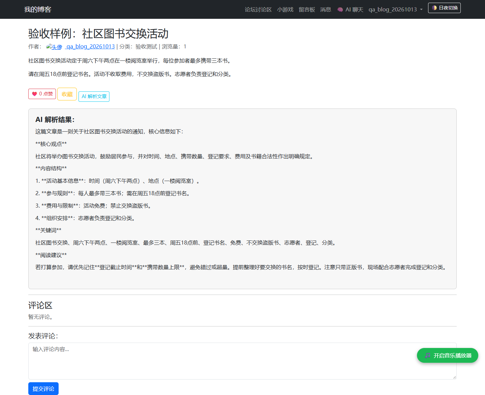
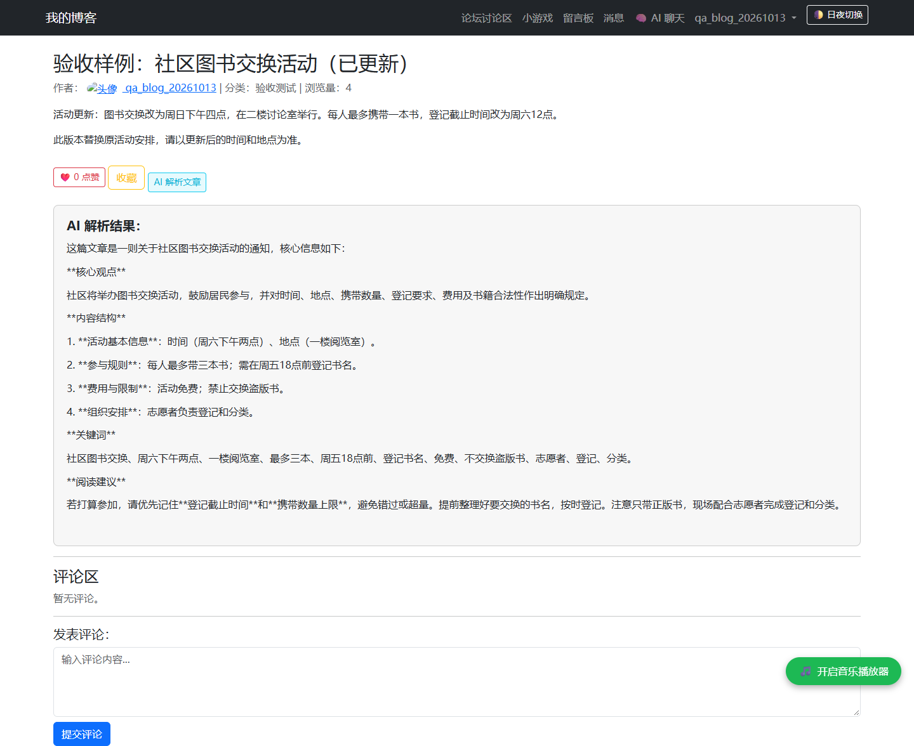

# AI 文章解析验收记录

验收日期：2026 年 10 月 13 日。浏览器用例执行时间约为北京时间 12:41。

执行方式：Codex 根据验收要求，通过 Playwright 操作真实浏览器并保存证据。本文记录当前代码的行为；本次没有修改业务代码，修复后回归尚未执行。

**结论：首次真实解析与重复请求缓存读取通过；匿名与配置缺失的后端分支符合预期，但前端提示和按钮恢复失败；正文更新后仍返回旧解析。现有 8 个 Agent 测试通过，含模拟模型。**

## 1. 环境与测试边界

| 项目 | 本次实际情况 |
| --- | --- |
| 原虚拟环境 | 启动失败，原解释器路径已不存在；作者说明此前重置过电脑 |
| 本次解释器 | Codex 提供的 CPython 3.12.14，加载项目现有 `.venv/Lib/site-packages` |
| 主要依赖 | Django 5.2.1、openai 1.82.1、python-dotenv 1.0.1；详见 [environment.json](environment.json) |
| 浏览器 | Edge 155.0.4283.45，Playwright 自动操作，1440 × 1100 视口，全页截图 |
| 测试数据库 | 新建隔离 SQLite，执行项目现有迁移；没有复制原业务数据 |
| 测试账号与文章 | 专用账号 `qa_blog_20261013`；两篇无敏感内容的示例文章 |
| 正常服务 | `http://127.0.0.1:18765`，读取现有后端模型配置 |
| 空密钥服务 | `http://127.0.0.1:18766`，仅该进程覆盖模型密钥为空；原 `.env` 不变 |
| 外部模型调用 | 共 1 次成功请求，服务端返回合计 310 tokens；没有据此估算金额 |
| 请求限制 | 仅验收进程将模型请求超时设为 45 秒、SDK 自动重试设为 0；未改源码默认行为 |
| 收尾 | 已停止本次启动的两个测试服务，保留隔离测试数据和证据 |

请求配置中的模型名为 `deepseek-chat`，真实响应的 `model` 字段为 `deepseek-flash`。这里只记录两项观察，尚未核验名称不同的原因。详见 [model-calls.jsonl](model-calls.jsonl)。

原 `.env`、原 `db.sqlite3` 和纳入检查的业务源码均保持不变，见 [preservation.json](preservation.json)。本次成功启动的是隔离验收环境；原虚拟环境没有被重建，全新依赖安装也没有被验证。

## 2. 验收结果总表

| 用例 | 实际请求与响应 | 页面与数据结果 | 结论 |
| --- | --- | --- | --- |
| V1 首次解析 | POST → 200；`cached=false`；新增 1 次真实模型请求 | 显示与原文相符的内容；按钮恢复；保存解析 | 基础功能通过，仍有格式瑕疵 |
| V2 重复解析 | POST → 200；`cached=true`；新增模型请求 0 次 | reply 与 V1 完全相同，按钮可再次使用 | 缓存读取通过 |
| V3 匿名访问 | POST → 302 登录重定向 → GET 登录页 200 HTML | 前端将 HTML 当 JSON 解析，通用失败提示，按钮持续禁用 | 后端登录限制通过；页面处理失败 |
| V4 空密钥 | POST → 503；`error=AI 服务尚未配置。` | 前端使用不存在的 reply，触发异常，按钮持续禁用 | 后端配置错误分支通过；页面处理失败 |
| V5 正文更新 | 编辑 POST → 302；再次解析 200、`cached=true` | 新正文已保存，但 reply 与 V1 完全相同，仍是旧安排 | 复现旧缓存未失效问题 |
| V6 现有测试 | 运行 `blogapp.tests_agent`，8 个测试，退出码 0 | 8/8 通过，模型相关用例使用 FakeClient/mock | 指定测试通过，真实 Agent 流程未覆盖 |

V1 本次单样本约 5209 ms，V2 约 149 ms，计时包含浏览器自动操作等待，不是性能基准，不能据此宣传稳定提效比例。

## 3. 一步一步怎样操作与判断

### 第一步：先确认使用测试环境

1. 确认解释器、依赖和模型配置是否可读取，只记录密钥“是否存在”，不展示值。
2. 在隔离 SQLite 中执行迁移，创建专用用户及其 UserProfile、测试分类和两篇示例文章。
3. 确认两篇文章均没有 ArticleAnalysis。初始解析总数为 0，见 [database-before.json](database-before.json)。
4. 在浏览器实际提交登录表单，进入文章 1 的详情页。
5. 保存解析前的页面，见 [00-before-analysis.png](00-before-analysis.png)。

初始正文的关键事实：**周六下午两点、一楼阅览室、每人最多三本书、周五 18 点前登记**。这组具体信息用于判断模型回答是否对应原文。

### 第二步：验证首次真实解析 V1

1. 登录后打开文章 1，点击“AI 解析文章”。
2. 检查 POST `/article/1/ai_parse/`：请求体为 `{}`，带 CSRF 请求头。
3. 检查返回 `200`、`cached=false` 和非空 `reply`。
4. 对照原文阅读结果：时间、地点、携带数量和登记要求均相符。
5. 检查按钮恢复可用，并检查有解析记录写入数据库。

结果：通过基础功能检查。新增 1 次真实服务请求；页面仍直接显示部分 `**` Markdown 标记，列表阅读建议挤在同一段，格式体验尚不完整。

保存：[页面截图 v1.png](v1.png)、[请求响应与页面状态 v1.json](v1.json)、[模型调用记录](model-calls.jsonl)。

### 第三步：验证重复请求 V2

1. 用同一登录会话再次打开同一篇文章，不清除解析缓存。
2. 再次点击“AI 解析文章”。
3. 检查 `200`、`cached=true`。
4. 比较返回的完整 `reply` 与 V1 是否相同，同时核对模型请求记录是否增加。

结果：reply 完全相同，模型请求累计数仍为 1，按钮恢复正常。最终数据库中这篇文章仍只有一条解析记录。

保存：[页面截图 v2.png](v2.png)、[响应 v2.json](v2.json)、[数据库最终状态](database-after.json)。页面外观不能单独证明缓存命中，`cached` 字段和调用记录是必要证据。

### 第四步：验证匿名访问 V3

1. 创建不带登录会话的独立浏览器上下文，打开文章 1。
2. 保留页面正常生成的 CSRF Token，点击 AI 解析，避免把 CSRF 拒绝误认为登录限制。
3. 观察完整请求链：POST 解析接口返回 302，Fetch 自动跟随到登录页，收到 200 HTML。
4. 检查页面提示、控制台以及按钮能否再次使用。

结果：后端阻止了匿名解析，没有新增模型调用。页面仍停留在文章页，显示“AI解析失败，请稍后再试。”，没有引导用户登录，按钮被持续禁用。控制台出现 HTML 不能按 JSON 解析的错误。

保存：[截图 v3.png](v3.png)、[包含重定向链与错误的 v3.json](v3.json)。

### 第五步：验证空密钥 V4

1. 使用仅测试进程中清空密钥的服务，打开文章 2；该文章没有缓存。
2. 使用已登录的测试会话点击 AI 解析。
3. 检查响应为 `503`，JSON 含 `error: AI 服务尚未配置。`。
4. 观察页面是否呈现这条明确信息，按钮是否恢复。

结果：后端分支符合预期。前端读取不存在的 `data.reply`，在字符串替换时出现 `TypeError`，最终只显示通用失败提示，按钮没有恢复。这篇文章没有创建解析记录。

保存：[截图 v4.png](v4.png)、[响应与错误 v4.json](v4.json)、[空密钥服务日志](server-empty-key.log)。空密钥只作用于测试进程，原配置没有改动。

### 第六步：验证正文更新 V5

1. 使用正常服务与登录账号打开文章 1 的编辑页。
2. 通过 CKEditor 设置新的测试正文，再点击“保存修改”；保留原测试分类和标签。
3. 新安排改为：**周日下午四点、二楼讨论室、每人最多一本书、周六 12 点前登记**。
4. 确认编辑请求返回 302，并且详情页与数据库都显示新正文。
5. 再次点击 AI 解析，比较结果与 V1。

结果：正文成功保存，但解析返回 `cached=true`，reply 与 V1 完全相同，仍含“周六下午两点、一楼阅览室、最多三本书”。没有新增模型请求。当前缓存没有随正文修改失效。

保存：[保存前编辑页截图](05-edit-before-save.png)、[编辑响应 v5-edit.json](v5-edit.json)、[新正文与旧解析同屏截图 v5.png](v5.png)、[解析响应 v5.json](v5.json)、[数据库最终状态](database-after.json)。

### 第七步：运行现有测试 V6

通过隔离设置执行 Django 的 `blogapp.tests_agent` 测试模块。测试运行器另建临时内存数据库，测试后自动销毁，不使用原业务库。

结果：`Ran 8 tests`、`OK`，退出码 0。保存 [完整测试输出 agent-tests.txt](agent-tests.txt)。这些用例覆盖所测 Agent、检索与授权逻辑，真实文章解析由 V1 单独验证；真实 Agent 多步模型调用尚未验证。

启动检查和测试输出中有 `ckeditor.W001` 维护与安全警告，本次没有处理；不能表述为“检查无警告”。

## 4. 应保存哪些截图与结果

| 文件 | 用来证明什么 |
| --- | --- |
| [00-before-analysis.png](00-before-analysis.png) | 测试文章原始内容、已登录页面与解析入口 |
| [v1.png](v1.png) + [v1.json](v1.json) | 首次真实解析结果与 `cached=false` |
| [v2.png](v2.png) + [v2.json](v2.json) | 重复请求页面与 `cached=true` |
| [v3.png](v3.png) + [v3.json](v3.json) | 匿名请求重定向、页面提示和禁用按钮 |
| [v4.png](v4.png) + [v4.json](v4.json) | 空密钥 503、前端错误与按钮未恢复 |
| [05-edit-before-save.png](05-edit-before-save.png) + [v5-edit.json](v5-edit.json) | 编辑了什么，以及表单保存是否成功 |
| [v5.png](v5.png) + [v5.json](v5.json) | 正文已更新，但 AI 解析还停留在旧版本 |
| [model-calls.jsonl](model-calls.jsonl) | 真实模型调用次数、返回模型标识与 token 用量 |
| [database-before.json](database-before.json)、[database-after.json](database-after.json) | 新建测试数据、解析保存与空密钥场景未保存结果 |
| [agent-tests.txt](agent-tests.txt)、[setup-output.txt](setup-output.txt) | 测试结果、迁移与检查输出 |
| [server-real.log](server-real.log)、[server-empty-key.log](server-empty-key.log) | 实际 HTTP 路径、状态和开发服务日志 |
| [preservation.json](preservation.json) | 原配置、原数据库与业务源码未改动 |

截图来自真实浏览器页面；请求与控制台证据另存为脱敏 JSON。自己复测时可按 F12 打开 Network，勾选 Preserve log，点击按钮后选中 `ai_parse/` 请求，查看 Status、Response 和重定向链；再到 Console 查看报错。

截图前隐藏 Cookie、CSRF 值、密码和模型密钥。此次 JSON 只记录是否携带相关请求头，没有保存登录 Cookie、Authorization 值或整份原始 HAR。

截图中头像加载失败是因为隔离媒体目录未复制原上传资源；日志也有头像和 favicon 的 404。它们已保留在原始证据中，不据此认定原站点头像一定损坏。

## 5. 已定位问题与建议处理方式

| 问题 | 判断依据 | 建议处理，尚未实施 |
| --- | --- | --- |
| 错误后无法直接重试 | V3、V4 的 `button_disabled=true`；catch 没有恢复按钮 | 将按钮恢复放入 `finally`；先检查状态、重定向和响应类型，再解析并展示 error |
| 匿名用户缺少明确引导 | 后端 302 后返回 HTML，前端仍按 JSON 处理 | 明确选择页面登录引导或统一 API 鉴权响应，并同步前端处理约定 |
| 正文改变后解析过期 | 编辑成功，正文改变，解析与 V1 相同且没有调用模型 | 定义缓存失效策略：正文版本或摘要关联解析，或在编辑成功后使解析失效 |
| 输出格式不完整 | V1 页面直接显示 `**`，部分列表连续展示 | 统一后端输出格式与前端渲染规则，兼顾转义和允许标签范围 |

这些是建议，不是修复完成声明。当前没有验证错误密钥、余额不足、超时、并发、长文本、XSS、完整对象权限或生产部署等其他场景。

## 6. 对照代码阅读验证链路

V1、V4、V5 的截图与 JSON 分别展示了正常解析、配置错误和正文更新后的缓存命中，可结合以下代码入口阅读：

- [解析视图](../../../blogapp/views_chatbot.py)：登录与请求方法、缓存查询、模型请求及错误分支。
- [模型客户端](../../../blogapp/agent/client.py)：服务端配置读取与 SDK 初始化。
- [页面脚本](../../../templates/blogapp/article_detail.html)：Fetch、JSON 读取、结果渲染和按钮状态。
- [文章编辑](../../../blogapp/views.py)：表单保存与正文修改。

后续修复应保留原失败用例，再增加对应的回归结果，便于比较行为变化。

## 7. 复现说明与脱敏

通用配置、迁移和启动步骤见 [README](../../../README.md)。本次机器专用的验收启动命令与临时登录信息保留在本机工作区，不随仓库发布。环境记录中的解释器绝对路径已标记脱敏，版本、响应和测试结果保留原始观察。

文章 1 已有解析缓存且正文已更新。再次验证首次模型请求时，应创建新的测试文章；重复命中缓存不能用来证明一次新的模型调用。
